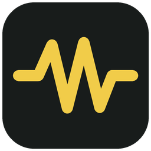
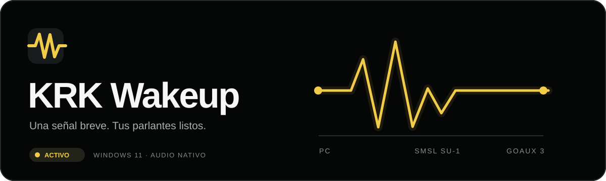
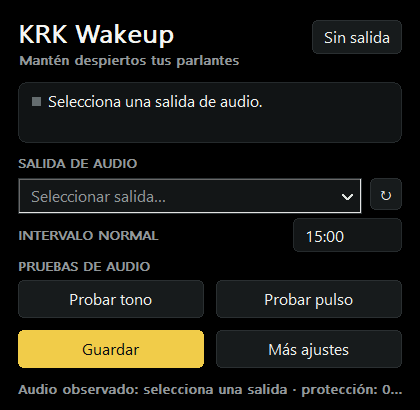
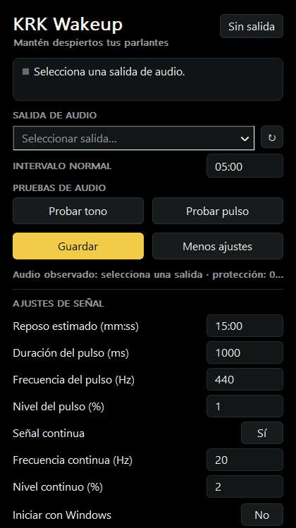

<p align="center">
  
</p>

<p align="center">
  <a href="README.md">Español</a> · <a href="README.en.md">English</a>
</p>

<p align="center">
  <a href="LICENSE"></a>
  
  
  
  
  
  
</p>

**KRK Wakeup** is a small Windows utility that sends a short audio signal to an output you choose. It was created to prevent KRK GoAux 3 speakers connected over RCA to an SMSL SU-1 from entering standby during long pauses.

> **Status:** v0.4.2 is published in [Releases](https://github.com/reiterstahl/krk-wakeup/releases). In the physical test the GoAux stopped going to standby, both with the continuous tone and with the **continuous level at 0 %** (stream kept open in silence plus 80 Hz, 3000 ms, 1 % pulses every 15 minutes). v0.4.1 also softens the start and stop of the continuous tone. It adds a **continuous signal** (20 Hz at 2 %) on a stream that stays open, so the DAC no longer idles between pulses; pulses wait for an idle DAC to wake, offset the Windows volume, and are no longer deferred by observed audio.

<p align="center">
  
</p>

## Interface

<p align="center">
  
</p>

<details>
<summary>View signal settings</summary>

<p align="center">
  
</p>

</details>

These are captures of the actual Windows interface with no audio output selected. Sharpness at 4K depends on Windows DPI scaling; a physical 4K monitor check is still pending.

## Continuous signal (v0.4.0)

Earlier versions sent a one-second pulse every few minutes and closed the stream. The v0.4.0 review found three weaknesses in that signal, not in the timer:

- **The DAC idled between pulses.** With no stream open, Windows stops feeding the SMSL SU-1; when the pulse arrives the DAC is still waking and can swallow its start, or all of it. This happens exactly when nothing else plays through the DAC: with headphones, or with the display off.
- **The level depended on the Windows volume.** The 1 % is applied before the volume: at 20 % volume the pulse left about 24 dB weaker than at 100 %.
- **A brief sound deferred the pulse.** A Windows notification counted as "useful audio" and postponed the pulse a full interval.

What it does now:

- **Continuous signal** (**Señal continua**). While active, the app keeps a stream open on the saved output so the DAC never idles. Since v0.4.2 it defaults to **level 0 %**: the stream carries only inaudible noise, no tone, and does not show on audio visualizers; this is the setup that worked in the physical test. **Más ajustes** has the on/off switch, frequency, and level. A level above 0 adds a continuous tone (for example 20 Hz at 2 %, the default in v0.4.0 and v0.4.1).
- **Gentle start and stop (v0.4.1).** When the stream opens, the tone waits 2 s in silence and then fades in; on pause or exit it fades out over 0.3 s. In v0.4.0 the tone came in while the DAC was still opening and was cut in 5 ms on close, which could be heard as a thump.
- **Pulses with a lead-in.** If nothing is playing on the output, the pulse is preceded by 1.5 s of inaudible lead-in so the DAC wakes before the tone. With the continuous signal on, it is not needed and the pulse plays at once.
- **Volume compensation.** The digital level rises to offset the Windows volume and the app's volume in the mixer, by at most 10 times and never above 50 % digital. When the volume goes up, the level drops within a few hundredths of a second. Disable it with `CompensateVolume=0` in `settings.ini`. **Probar tono** is not compensated.
- **No deferral.** Pulses always go out on time.
- **No call ducking.** The app asks Windows not to lower its volume while a call is in progress.

The window's second status line shows the applied state: "Señal continua: activa · 20 Hz · 2 %", or why it is not active (output unavailable, in exclusive use, muted in Windows). "sube el volumen de Windows" means the volume is so low that the compensation reached its cap.

Two things to know. Windows treats an open stream as a reason **not to sleep the computer when idle**; turning the display off is unaffected. And if speakers on another setup still turn off, raise the continuous level first (for example to 2 %) and then the frequency (for example 30–40 Hz), one at a time.

## Intervals and protection mode

- **Screen on, session unlocked, saved DAC used as the default output:** retains **Intervalo normal**.
- **Headphones or another default output, locked session, off or dim display:** uses the shorter of the normal interval and **five minutes**.
- **Unknown or stale default-output/display information:** also activates protection. Normal intervals shorter than five minutes remain unchanged.

The default route is checked roughly once per second with [GetDefaultAudioEndpoint](https://learn.microsoft.com/en-us/windows/win32/api/mmdeviceapi/nf-mmdeviceapi-immdeviceenumerator-getdefaultaudioendpoint), for the console and multimedia roles. Either role pointing elsewhere activates protection. This only affects timing: **pulses still target the saved SMSL output**. The scheduler checks routing independently of the window timer.

Entering or leaving protection recalculates the deadline from the last pulse instead of starting a new full wait. An overdue pulse is sent on reevaluation. The window shows **protección: 05:00**, or your shorter interval. Audio errors still retry every five seconds.

Since v0.4.0 observed audio no longer defers pulses in any mode: the meter reads before the Windows volume and cannot tell a brief notification from signal the speakers noticed. **Probar tono** and **Probar pulso** remain available while paused. Display changes use [Windows session notifications](https://learn.microsoft.com/en-us/windows/win32/power/power-setting-guids); session lock activates protection even if no display notification arrives.

The utility aims to **prevent** standby; it is not considered able to turn the KRK speakers back on after they shut down.

## Why it exists

GoAux speakers can enter standby after receiving no signal for some time. In this setup, standby was initially estimated at **about 15 minutes**. Failure with a 20-minute pulse interval shows that interval leaves insufficient margin, but does not establish the exact standby time. The [official KRK manual](https://cdn.shopify.com/s/files/1/0566/0809/6342/files/KRK-GoAux-Monitor-System-Product-User-Manual.pdf?v=1705178896) explains how to control standby manually, but does not specify the automatic standby interval or the minimum signal level that resets it. Both need to be checked with the actual speakers.

The idea is simple: while the utility is active, it sends a discreet pulse before the speakers go to sleep. The default test interval is **5 minutes**, and you can change it.

## Features

- A notification area icon next to the Windows clock and a compact OLED black window. Audio tests, main actions, and advanced settings are grouped separately. Fonts and controls scale with each monitor’s DPI for sharp rendering on high-resolution displays; visual validation on a real 4K monitor is still pending.
- A fixed audio output: changing the Windows default output to Bluetooth headphones does not change where the pulse goes.
- A three-second audible test tone (440 Hz at 5% digital level), a test of the configured pulse, pause, a configurable normal interval, and automatic protection capped at five minutes with headphones, session lock, or an off/dim screen.
- Additional settings for estimated standby time, pulse duration, frequency, and digital level.
- Optional startup when the current user signs in to Windows, without an installer or administrator rights.
- Retry audio failures every 5 seconds and request an immediate pulse when Windows resumes; pulses are never redirected automatically to another output.
- Detailed **opt-in diagnostics, initially off**, with a report per run and audio error, screen, lock, and power events.
- A counter for the last audio activity observed on the selected output, including other apps, with endpoint mute/volume context.
- Recovery from blocked audio calls using a renderer process with a deadline; pausing, exiting, or switching outputs cancels the active attempt.

The initial target setup is **Windows 11 x64 → USB → SMSL SU-1 → RCA → KRK GoAux 3**. Windows 10 is a later compatibility goal and still requires testing.

## Download and test

1. Open [Releases](https://github.com/reiterstahl/krk-wakeup/releases), download **`krk-wakeup-v0.4.2-windows-x64.zip`** from **v0.4.2**, and extract its contents to a stable folder. It includes `krk-wakeup.exe`, the license, and documentation. Development builds remain available in [Windows build](https://github.com/reiterstahl/krk-wakeup/actions/workflows/windows.yml).
2. If an older version is running, choose **Salir** (Exit) from its notification area menu before replacing the `.exe`. Your settings will remain in place. Run the new version manually once: if startup was enabled, it will update the registered path to this executable.
3. Open the app and select the playback output corresponding to the **SMSL SU-1**. You can compare its name with **Settings → System → Sound** in Windows.
4. Set the GoAux speakers to a comfortable volume, then click **Probar tono** (Test tone). It plays for three seconds at 440 Hz and 5% digital level only through the selected output, even if the app is paused. Confirm that you hear it on the GoAux and nowhere else. Next, click **Probar pulso** (Test pulse): it uses the configured automatic signal, initially **80 Hz**, **3000 ms**, and **1%** digital level, with a 15:00 normal interval and a 25:00 estimated standby. Change these values under **Más ajustes** (More settings) if the signal is annoying or fails to prevent standby.
5. Save your settings. Switch the Windows default output to Bluetooth headphones and confirm the test still plays only through the DAC. Then leave the GoAux without other audio for longer than their usual standby time and check whether they remain active.

Time fields use `mm:ss`. **Reposo estimado** (Estimated standby) is a calibration reference; it does not change the KRK speakers' internal timer. **Intervalo normal** controls the base deadline in normal mode; protection caps it at five minutes without meter-based deferral. The app warns you if the interval equals or exceeds the estimated standby time.

**Frecuencia** (Frequency) accepts **10 to 15000 Hz**. To try a low frequency, use **Probar pulso** (Test pulse), which plays your configured settings. **Probar tono** (Test tone) remains the fixed audible test at 440 Hz. Low frequencies are experimental: their effectiveness at preventing standby still needs to be checked on the GoAux.

A **20-minute** interval did not prevent standby in the tested GoAux; **18 minutes** initially worked, but intermittent standby later occurred at both 18 and 15 minutes while the screen was off and the PC stayed awake. A single missed pulse at that interval can leave about 36 minutes without an effective signal. v0.3.0 added a five-minute screen-off cap, but another standby incident was reported while using headphones. v0.3.1 extends protection to other default outputs, session lock, and dim displays, and disables meter-based deferral within that mode. If they go to sleep even with a short interval, use **Probar tono** (Test tone) to confirm the audio route, then change pulse level and duration one at a time. KRK does not publish the GoAux detection threshold in its manual. Also check that neither Windows nor the SMSL SU-1 is muted.

**Locking Windows with Win + L** leaves the utility running while the computer remains awake. If Windows enters sleep or hibernation, desktop processes pause and the app requests a new pulse on resume if it is enabled and has a selected output. See [Microsoft's sleep documentation](https://learn.microsoft.com/en-us/windows-hardware/design/device-experiences/integrating-apps-with-modern-standby).

## Opt-in diagnostics and last activity

Right-click the notification area icon and choose **Activar diagnóstico** (Enable diagnostics). The choice is saved immediately and persists across launches. **Desactivar diagnóstico** stops writes. Diagnostics start off, including when upgrading from v0.1.3. The window’s activity counter continues in memory while file logging is off.

**Abrir registros** opens `%LOCALAPPDATA%\KRKWakeup\Logs`. Each run gets `krk-wakeup-<UTC>-<PID>.log`, with an instance ID, version, signal settings, and UTC timestamps. Reports rotate at approximately 1 MiB; up to 12 parts/reports are retained. Old v0.1.3 logs remain in their previous location.

| Report field | What it shows |
| --- | --- |
| `pulse_start`, `pulse_ok`, `pulse_error` | Each attempt, lateness, result, duration, and error stage/code. |
| `last_pulse_utc`, `last_pulse_age_ms` | Last Windows-confirmed pulse on the current output and elapsed time. |
| `last_audio_utc`, `last_audio_age_ms` | Last observed signal on that output, including other apps. |
| `poll_age_ms`, `progress_age_ms`, `attempt_age_ms` | Whether the observer was responding, reconnecting, or no longer obtaining readings. |
| `display_state`, `session_lock`, `power_suspend`, `power_resume` | Screen, session lock, and actual sleep/resume events. |
| `screen_policy`, `lock_policy`, `output_policy`, `protection`, `effective_interval_s` | Display, lock, and route changes; protection state and effective interval. |
| `default_output_known`, `selected_is_default` | Whether routing was readable and matches the saved output. Device identifiers are not logged. |
| `keepalive_state`, `keepalive_played_ms`, `keepalive_digital_level_pct`, `keepalive_path_gain`, `keepalive_underruns` | Continuous-signal state, audio Windows consumed, digital level after compensation, Windows volume gain, and dropouts. `stage=complete_cold` on `pulse_ok` means the pulse carried a lead-in for an idle DAC. |
| `heartbeat` | A 30-second summary of audio, screen state, effective interval, and worker state. |

The window shows **Audio observado hace mm:ss** (Audio observed mm:ss ago). The saved output’s meter is sampled every 100 ms without opening a playback stream or recording audio. History starts when the app opens and resets when the selected output changes. With the continuous signal on, the counter stays near 00:00: the meter is seeing that signal.

There are limits: the [Windows meter](https://learn.microsoft.com/en-us/windows/win32/api/endpointvolume/nn-endpointvolume-iaudiometerinformation) operates before endpoint volume/mute, and software meters cannot observe exclusive streams. Each [reading covers one device period](https://learn.microsoft.com/en-us/windows/win32/api/endpointvolume/nf-endpointvolume-iaudiometerinformation-getpeakvalue), so sampling can miss brief sounds. Unknown or stale observations are not reported as confirmed silence. `pulse_ok` also cannot prove analog output over RCA or that the speakers reset their timer.

Reports store timing, state, and level metadata, not audio, computer names, executable paths, or device identifiers. For this trial, keep your normal interval and enable diagnostics: the report should show `protection=1` and `effective_interval_s=300` when using headphones or locking Windows (or your shorter interval). Manually turn the KRK speakers on before testing if they are already in standby. If standby recurs, keep that run’s report and note the approximate time.

## Reliability review

Playback now runs in a hidden, bounded copy of the same executable. A blocked driver call reaches a global deadline of pulse duration plus 10 seconds; the helper is terminated and the app retries. Initial buffer loading, drain verification, and start-to-start intervals are retained. Last-pulse history resets on output changes; pause, exit, and signal changes cancel old attempts.

The [v0.4.0 review](docs/REVIEW-2026-11-14.md) explains the continuous signal and how it was verified. The [v0.3.1 review](docs/REVIEW-2026-11-03.md) covers the headphones correction and tests; the [earlier review](docs/REVIEW-2026-10-18.md) covers audio isolation and diagnostics (Spanish). The never-returning audio call test uses a simulated renderer; physical SMSL SU-1 testing with the screen off remains necessary.

## Start with Windows

The executable is portable. Extract it to a folder where it will stay. In the app, open **Más ajustes** (More settings), switch **Iniciar con Windows** (Start with Windows) to **Sí** (Yes), and click **Guardar** (Save). The app writes the full `.exe` path to the [current user's `Run` key](https://learn.microsoft.com/en-us/windows/win32/setupapi/run-and-runonce-registry-keys); Windows launches it when you sign in to that account. No installer is needed. Since v0.4.2 this option is **on by default**: the first launch registers the path you opened it from, so extract it to its final folder first; to turn it off, switch it to **No** and click **Guardar**. Since v0.1.2, launching the app repairs a missing or stale entry when startup is enabled; **Guardar** also refreshes the registration every time. Windows CI tests that repair, but a real sign-in with the current version still needs checking.

If you move or rename the executable, open it from its new location to repair the path; clicking **Guardar** also updates it. At sign-in the app may start hidden in the notification area, so check the hidden icons near the clock. If it is absent, check that **KRK Wakeup** is enabled under **Windows Settings → Apps → Startup** and that the `.exe` remains in its folder. You can disable startup in the app. Settings are stored separately at `%LOCALAPPDATA%\KRKWakeup\settings.ini`.

## How it works

The app uses the [Windows audio device API](https://learn.microsoft.com/en-us/windows/win32/coreaudio/getting-the-default-device-endpoint-for-stream-routing) to save the selected output's identifier and open that output directly. It generates a short waveform with smooth fade-in and fade-out through [WASAPI shared mode](https://learn.microsoft.com/en-us/windows/win32/coreaudio/wasapi). Regular audio and Bluetooth headphones can coexist with the utility.

With this analog connection, Windows identifies the **SMSL SU-1**, not the speakers attached to its RCA outputs. The app can detect when the USB DAC disappears, but it cannot detect an unplugged RCA cable or powered-off GoAux speakers. Nor can software confirm that a pulse reset the speakers' internal standby timer: that must be checked on the speakers themselves.

The window and notification area icon use Win32, with a Per-Monitor V2 manifest and DPI scaling for fonts, controls, and drawing; audio uses WASAPI; builds use CMake and MSVC. The executable links the C++ runtime statically. The app needs no administrator privileges and does not modify the speakers' firmware.

## Build

Install Visual Studio 2022 with **Desktop development with C++** and CMake. In PowerShell:

```powershell
cmake -S . -B build -A x64
cmake --build build --config Release
```

The executable will be at `build\Release\krk-wakeup.exe`. Every change to `main` triggers a build, startup smoke test, startup registration repair test, audio drain/timing and protection policy tests, actual scheduler tests with simulated output changes and a pinned destination, blocked-renderer isolation tests, opt-in diagnostics tests, and a recovery check with simulated lock/resume notifications in GitHub Actions. These tests do not measure physical standby behavior; the [validation plan](docs/PLAN.md) describes that check (currently in Spanish).

## Project

KRK Wakeup is free and open-source software under the [MIT license](LICENSE), with copyright held by **reiterstahl**. You may use, modify, and redistribute the software, including commercially, provided you retain the copyright notice and license. The software is provided without warranty.

KRK Wakeup is an independent project and is not affiliated with KRK, Gibson, or SMSL.
