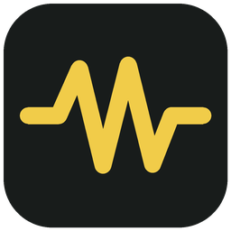
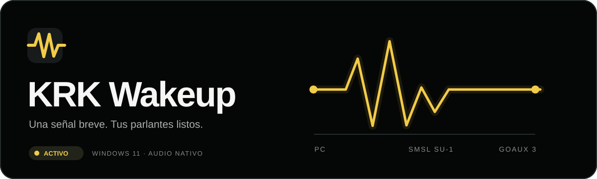
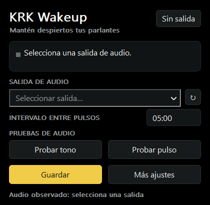
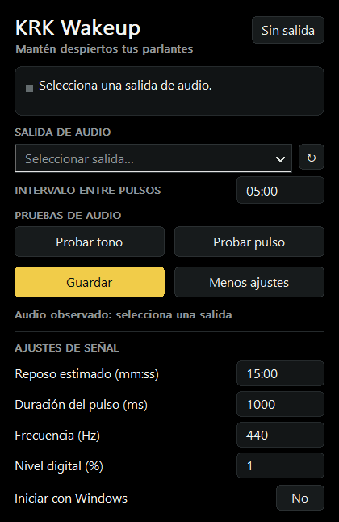

<p align="center">
  
</p>

<p align="center">
  <a href="README.md">Español</a> · <a href="README.en.md">English</a>
</p>

<p align="center">
  <a href="LICENSE"></a>
  
  
  
  
  
  
</p>

**KRK Wakeup** es una utilidad pequeña para Windows que envía una señal de audio breve a una salida elegida por el usuario. Nació para evitar que unos KRK GoAux 3 conectados por RCA a un SMSL SU-1 entren en reposo durante pausas largas.

> **Estado:** v0.1.3 publicada. Hay apagados intermitentes con un intervalo de 18 minutos, especialmente durante sesiones bloqueadas aunque el PC permanezca despierto. Esta versión corrige un caso que marcaba como exitoso un pulso sin terminar de consumir el audio y añade diagnóstico local. La causa del incidente concreto y la eficacia prolongada en los GoAux todavía requieren pruebas físicas.

<p align="center">
  
</p>

## Interfaz

<p align="center">
  
</p>

<details>
<summary>Ver ajustes de señal</summary>

<p align="center">
  
</p>

</details>

Las capturas muestran la interfaz real en Windows sin una salida de audio seleccionada. La nitidez en escala 4K depende del escalado DPI de Windows; todavía falta revisarla en un monitor 4K físico.

## Por qué existe

Los GoAux pueden entrar en reposo cuando llevan un tiempo sin recibir señal. En el equipo de prueba, el reposo se estimó inicialmente en **unos 15 minutos**; el fallo con un intervalo de 20 minutos confirma que ese intervalo no deja margen suficiente, pero no establece el tiempo exacto de reposo. El [manual oficial de KRK](https://cdn.shopify.com/s/files/1/0566/0809/6342/files/KRK-GoAux-Monitor-System-Product-User-Manual.pdf?v=1705178896) explica cómo controlar el reposo manualmente, pero no especifica el intervalo de reposo automático ni el nivel mínimo de señal que lo reinicia. Por eso ambos parámetros se validan en el equipo real.

La idea es sencilla: mientras la utilidad esté activa, genera un pulso discreto antes de que los parlantes se duerman. El intervalo predeterminado para las pruebas es **5 minutos** y se puede ajustar.

## Qué ofrece

- Icono junto al reloj de Windows y una ventana compacta con tema negro OLED. Las pruebas de audio, las acciones principales y los ajustes avanzados están separados en grupos. La interfaz ajusta fuentes y controles al DPI de cada monitor para verse nítida en pantallas de alta resolución; falta validarla visualmente en un monitor 4K real.
- Salida de audio fija: cambiar la salida predeterminada a auriculares Bluetooth no cambia el destino del pulso.
- Prueba de tono audible de 3 segundos (440 Hz, 5 % de nivel digital), prueba del pulso configurado, pausa, intervalo configurable y cuenta regresiva del siguiente envío.
- Ajustes ampliables de reposo estimado, duración, frecuencia y nivel digital de la señal.
- Inicio opcional al entrar en la cuenta de Windows, sin instalador ni privilegios de administrador.
- Reintentos cada 5 segundos ante fallos de audio y recuperación inmediata al reanudar Windows; nunca redirige los pulsos automáticamente a otra salida.
- Registro local de pulsos, errores de audio, bloqueo y suspensión, accesible desde **Abrir registro** en el menú junto al reloj. Detecta si Windows tiene silenciada la salida o la sesión de audio de la app.

El alcance inicial es **Windows 11 x64 → USB → SMSL SU-1 → RCA → KRK GoAux 3**. Windows 10 queda como objetivo de compatibilidad posterior, sujeto a pruebas.

## Descargar y probar

1. En [Releases](https://github.com/reiterstahl/krk-wakeup/releases), descarga **`krk-wakeup-v0.1.3-windows-x64.zip`** de la versión **v0.1.3** y extrae su contenido en una carpeta estable. Incluye `krk-wakeup.exe`, la licencia y la documentación. Las compilaciones de desarrollo siguen disponibles en [Windows build](https://github.com/reiterstahl/krk-wakeup/actions/workflows/windows.yml).
2. Si ya ejecutas una versión anterior, usa **Salir** en su icono junto al reloj antes de reemplazar el archivo `.exe`. La configuración se conserva. Ejecuta v0.1.3 manualmente una vez: si ya tenías activado el inicio con Windows, actualizará la ruta registrada para el nuevo ejecutable.
3. Abre la aplicación y selecciona la salida de reproducción que corresponde al **SMSL SU-1**. Puedes comparar su nombre con **Configuración → Sistema → Sonido** de Windows.
4. Con un volumen cómodo en los GoAux, pulsa **Probar tono**. Reproduce 3 segundos a 440 Hz y 5 % de nivel digital solo por la salida seleccionada, incluso si la aplicación está pausada. Confirma que se oye en los GoAux y no en otro dispositivo. Después, pulsa **Probar pulso**: usa la señal automática configurada, cuyo perfil inicial es **440 Hz**, **1000 ms** y **1 %** de nivel digital. Ajusta estos valores en **Más ajustes** si la señal molesta o no evita el reposo.
5. Guarda la configuración. Cambia la salida predeterminada de Windows a tus auriculares BT y comprueba que la prueba sigue saliendo solo por el DAC. Después, deja los GoAux sin otro audio durante más de su tiempo habitual de reposo y observa si permanecen activos.

Los campos de tiempo usan `mm:ss`. **Reposo estimado** sirve de referencia para calibrar; no modifica el temporizador interno de los KRK. **Intervalo entre pulsos** controla el envío real. Si el intervalo iguala o supera el reposo estimado, la app muestra un aviso.

**Frecuencia** acepta de **10 a 15000 Hz**. Para ensayar una frecuencia baja, usa **Probar pulso**, que reproduce tus ajustes. **Probar tono** sigue siendo la prueba audible fija de 440 Hz. Las frecuencias bajas son experimentales: su eficacia para evitar el reposo aún debe comprobarse en los GoAux.

Un intervalo de **20 minutos** no evitó el reposo en los GoAux de prueba; **18 minutos** funcionó inicialmente, pero después se observaron apagados intermitentes con el equipo bloqueado y despierto. Un único pulso perdido con ese intervalo puede dejar unos 36 minutos sin señal efectiva. Para uso provisional, el valor inicial de **5 minutos** deja más margen respecto a los 15 minutos estimados. Si se apagan incluso con un intervalo corto, usa **Probar tono** para confirmar la ruta de audio y ajusta nivel y duración de uno en uno. El umbral de detección de los GoAux no está publicado en su manual. Comprueba también que Windows y el SMSL SU-1 no estén silenciados.

**Al bloquear Windows con Win + L**, la utilidad sigue ejecutándose mientras el equipo permanezca encendido. Si Windows entra en suspensión o hibernación, los procesos de escritorio se pausan y la app solicita un nuevo pulso al reanudar, siempre que esté activa y tenga una salida seleccionada. [Documentación de Microsoft sobre suspensión](https://learn.microsoft.com/en-us/windows-hardware/design/device-experiences/integrating-apps-with-modern-standby).

## Diagnosticar un apagado

La versión 0.1.3 prepara el primer bloque antes de iniciar WASAPI y solo confirma el pulso cuando el búfer queda consumido. Si el búfer no termina de vaciarse, lo trata como un error y reintenta a los 5 segundos. El intervalo normal se mide entre comienzos de pulso; guardar ajustes no pospone un envío ya programado.

Si vuelve a ocurrir, abre **Abrir registro** en el menú del icono junto al reloj. El archivo está en `%LOCALAPPDATA%\KRKWakeup\diagnostics.log`. Guarda horas UTC, parámetros de señal, intentos (`pulse_start`), resultados (`pulse_ok` o `pulse_error`), códigos de error y eventos de bloqueo/suspensión. Un `heartbeat` cada minuto permite ver si la app seguía ejecutándose y cuánto tiempo llevaba sin un envío confirmado. Al alcanzar aproximadamente 1 MiB conserva una copia anterior en `diagnostics.previous.log`.

`pulse_ok` confirma que Windows consumió el búfer; no puede confirmar que el DAC emitiera una señal suficiente ni que los parlantes reiniciaran su temporizador. Si un controlador tarda más de 15 segundos en responder, la app muestra **Audio sin respuesta** y lo registra; una llamada bloqueada dentro del controlador todavía puede requerir reiniciar la app. Los registros son locales y no contienen nombres del equipo, rutas del ejecutable ni identificadores de dispositivos.

Para las primeras pruebas de esta corrección, un intervalo de **5 a 10 minutos** deja más margen que 18 minutos. Si los parlantes se apagan, conserva el registro antes de cerrar la app e indica la hora aproximada: permitirá distinguir un error de Windows, un retraso y un pulso confirmado que no evitó el reposo físico.

## Inicio con Windows

El ejecutable es portable. Extráelo primero a una carpeta donde vaya a permanecer. En la app, abre **Más ajustes**, cambia **Iniciar con Windows** a **Sí** y pulsa **Guardar**. La app guarda la ruta completa del `.exe` en la [clave `Run` de tu usuario](https://learn.microsoft.com/en-us/windows/win32/setupapi/run-and-runonce-registry-keys); Windows lo iniciará al entrar en esa cuenta. No hace falta instalarlo, y la opción viene desactivada inicialmente. Desde v0.1.2, abrir la app repara una entrada ausente o con ruta anterior si la opción estaba activada; **Guardar** también actualiza siempre el registro. La reparación se prueba automáticamente en Windows, aunque todavía falta comprobar un nuevo inicio de sesión real con la versión actual.

Si mueves o renombras el ejecutable, abre la app desde su nueva ubicación para que repare la ruta; también puedes pulsar **Guardar**. Al entrar en Windows, la app puede iniciar oculta en el área de notificación: revisa los iconos ocultos junto al reloj. Si no aparece, comprueba que **KRK Wakeup** esté activado en **Configuración → Aplicaciones → Inicio** de Windows y que el `.exe` permanezca en su carpeta. Puedes desactivar el inicio desde la app. Los ajustes se guardan aparte en `%LOCALAPPDATA%\KRKWakeup\settings.ini`.

## Cómo funciona

La aplicación usa la [API de dispositivos de audio de Windows](https://learn.microsoft.com/en-us/windows/win32/coreaudio/getting-the-default-device-endpoint-for-stream-routing) para guardar el identificador de la salida seleccionada y abrirla directamente. El generador envía una onda breve con entrada y salida suaves mediante [WASAPI en modo compartido](https://learn.microsoft.com/en-us/windows/win32/coreaudio/wasapi). El audio normal y los auriculares BT pueden convivir con la utilidad.

En esta conexión analógica Windows identifica el **SMSL SU-1**, no los parlantes conectados al otro extremo de los RCA. Puede detectar si desaparece el DAC USB, pero no si se retira solo el cable RCA o se apagan los GoAux. Tampoco puede confirmar por software que un pulso haya reiniciado el temporizador interno de los parlantes: eso se comprueba observándolos.

La ventana y el icono usan Win32, con manifiesto Per-Monitor V2 y escalado DPI de fuentes, controles y dibujo; el audio, WASAPI; la compilación, CMake y MSVC. El ejecutable enlaza el runtime de C++ estáticamente. La aplicación no requiere privilegios de administrador ni modifica el firmware de los parlantes.

## Compilar

Instala Visual Studio 2022 con **Desktop development with C++** y CMake. En PowerShell:

```powershell
cmake -S . -B build -A x64
cmake --build build --config Release
```

El archivo estará en `build\Release\krk-wakeup.exe`. Cada cambio en `main` ejecuta la compilación y pruebas de arranque, registro de inicio, vaciado/temporización y recuperación con eventos de bloqueo y reanudación simulados en GitHub Actions. Estas pruebas no miden el reposo físico; los [pasos de validación](docs/PLAN.md) describen esa comprobación.

## Proyecto

KRK Wakeup es software libre bajo la [licencia MIT](LICENSE), con copyright de **reiterstahl**. Permite usar, modificar y redistribuir el software, incluso comercialmente, conservando el aviso de copyright y la licencia. El software se proporciona sin garantías.

KRK Wakeup es un proyecto independiente y no está afiliado a KRK, Gibson ni SMSL.
